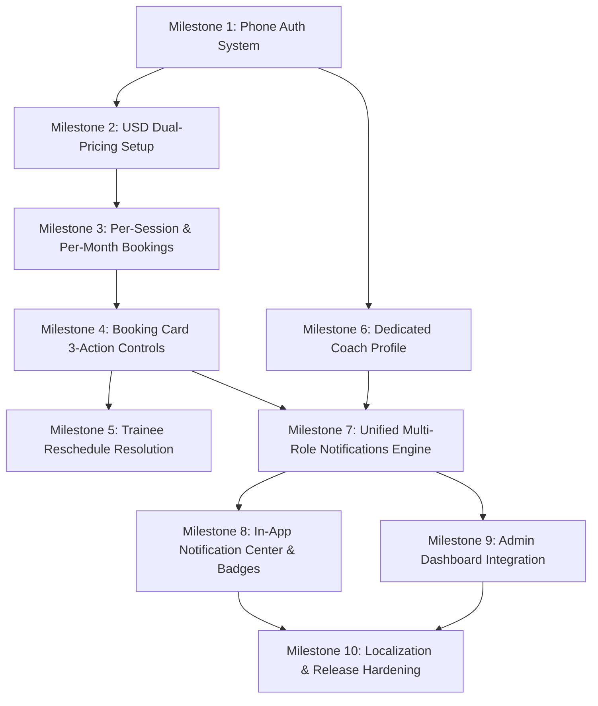

# CoachHub Mobile App — Implementation Roadmap: Phase 2

> **Project Name**: `fitness_app` (CoachHub Mobile)  
> **Platform**: Flutter (Android & iOS)  
> **Connected Firebase Project**: `coach-hub-app-522cd`  
> **Phase Target**: Client Review Iteration & Feature Expansion (Phase 2)  
> **Core Theme**: Phone-Only Authentication (EG & LB), Dual USD Pricing (Session & Monthly), 3-Way Booking Actions, Dedicated Coach Profile, and Unified Notification Engine (Trainee, Coach, & Admin).

---

## 1. Architectural Standards & Core Principles

All code created or modified in Phase 2 must adhere strictly to these architectural rules:

1. **Strict Anti-Overengineering**:
   - **NO Domain Entities**: NEVER create separate entity classes that mirror models. Use Models (`UserModel`, `CoachProfileModel`, `TraineeProfileModel`, `BookingModel`, `NotificationModel`) directly across data sources, repositories, Cubits, and UI.
   - **NO Use Cases**: NEVER create UseCase classes (e.g., `SendOtpUseCase`, `ApproveBookingUseCase`). Cubits must call concrete repositories or services directly.
   - **NO Abstract Classes for Repositories or Data Sources**: Implement concrete repositories and data sources directly (e.g., `class AuthPhoneRepository`, `class NotificationsRepository`).
2. **State Management**:
   - `flutter_bloc` (`Cubit` pattern) is the mandatory state management standard.
   - UI widgets must never query Firestore directly; all data fetching and mutations delegate to Cubits.
   - States must be immutable, utilizing `copyWith` or distinct subclasses.
3. **Modularity & File Length Limit**:
   - **Strict 150-line file limit**: Any file approaching 150 lines must be split immediately.
   - Screen files (`*_view.dart`) handle only high-level layout/scaffolding and delegate content to sub-widgets located in `widgets/`.
   - Private widget classes (`_MyWidget`) are permitted only for trivial wrappers (≤ 20 lines).
4. **Design & Responsiveness**:
   - Material 3 theming with `flutter_screenutil` for proportional scaling across phone screens.
   - 60-30-10 color rule with complete Light and Dark theme support.
   - Shimmer loaders, explicit error banners with retry triggers, and friendly empty states.
5. **Strict Localization (l10n)**:
   - **Zero hardcoded user-facing strings**. Every single label, error message, button, and badge must be localized via `S.of(context)`.
   - Synchronized ARB maintenance: Every new key must be added to both `lib/l10n/intl_en.arb` and `lib/l10n/intl_ar.arb` simultaneously.
   - Seamless LTR (English) and RTL (Arabic) support with dynamic directionality and alignment.

---

## 2. Updated Firebase Data Schemas (Phase 2)

### 2.1 Firestore Collections & Schema Definitions

| Collection | Document ID | Key Fields | Description |
| :--- | :--- | :--- | :--- |
| `users` | `uid` | `uid`, `phoneNumber`, `countryCode` (`'+20'` \| `'+961'`), `name`, `role` (`'coach'` \| `'trainee'` \| `'admin'`), `status` (`'active'` \| `'suspended'`), `createdAt`, `updatedAt` | Base account profile after phone verification |
| `coach_profiles` | `coachUid` | `uid`, `name`, `phoneNumber`, `photoUrl`, `bio`, `country`, `city`, `sports` (`List<String>`), `specialties` (`List<String>`), `sessionPriceUSD` (`double`), `monthlyPriceUSD` (`double`), `currency` (`'USD'`), `yearsOfExperience`, `rating`, `reviewsCount`, `workingDays`, `workingHours`, `isProfileCompleted`, `updatedAt` | Public coach profile and marketplace pricing |
| `trainee_profiles` | `uid` | `uid`, `name`, `phoneNumber`, `photoUrl`, `country`, `city`, `age`, `gender`, `sports` (`List<String>`), `level`, `goal`, `trainingType`, `isProfileCompleted`, `updatedAt` | Trainee profile preferences |
| `bookings` | `bookingId` | `id`, `coachUid`, `coachName`, `coachPhotoUrl`, `traineeUid`, `traineeName`, `traineePhotoUrl`, `sport`, `bookingType` (`'session'` \| `'monthly'`), `date`, `startTime`, `endTime`, `durationMonths` (`int?`), `monthlyScheduleNotes` (`String?`), `price` (`double`), `currency` (`'USD'`), `notes`, `status` (`'pending'` \| `'confirmed'` \| `'rejected'` \| `'reschedule_pending'`), `rejectionReason` (`String?`), `proposedDate` (`String?`), `proposedStartTime` (`String?`), `proposedEndTime` (`String?`), `rescheduleReason` (`String?`), `rescheduledBy` (`'coach'` \| `'trainee'`), `createdAt`, `updatedAt` | Training bookings supporting both per-session and per-month plans |
| `notifications` | `notificationId` | `id`, `recipientUid`, `recipientRole` (`'trainee'` \| `'coach'` \| `'admin'`), `senderUid`, `senderName`, `senderPhotoUrl`, `type`, `titleEn`, `titleAr`, `bodyEn`, `bodyAr`, `data` (`Map<String, dynamic>`), `isRead` (`bool`), `createdAt` (`DateTime`) | Global notifications store for Trainees, Coaches, and Admin |
| `admin_notifications` | `notificationId` | `id`, `type`, `sourceUid`, `sourceName`, `title`, `message`, `data`, `isRead` (`bool`), `createdAt` (`DateTime`) | Dedicated queue for Admin Dashboard monitoring |
| `fcm_tokens` | `uid` | `uid`, `token`, `platform` (`'android'` \| `'ios'`), `role`, `updatedAt` | Push notification device registration tokens |

---

## 3. Dependency Updates

### Remove / Deprecate:
- `google_sign_in` (Removed — No social auth)
- `sign_in_with_apple` (Removed — No social auth)
- Email/password authentication handlers & validators

### Add / Retain:
- `firebase_auth: ^6.7.0` (Configured for SMS Phone Verification)
- `pinput: ^5.0.0` (Modern, accessible OTP input widget for 6-digit codes)
- `flutter_local_notifications: ^19.0.0` (Foreground push heads-up alerts)
- `firebase_messaging: ^16.0.0` (Background push messaging)
- `flutter_bloc: ^9.1.1`, `get_it: ^9.3.0`, `go_router: ^17.5.0`
- `intl: ^0.19.0`, `intl_utils: ^2.8.7`

---

## 4. Phase 2 Implementation Milestones



---

### Milestone 1: Authentication Overhaul — Phone Number Sign-In (Egypt & Lebanon Only)

**Goal**: Completely replace email/password and social logins with a streamlined Phone Number OTP verification system restricted strictly to Egypt (`+20`) and Lebanon (`+961`).

- [x] **Step 1.1: Core Auth Service & Data Layer Refactoring**
  - Deprecate email/password, Google, and Apple sign-in methods in `AuthService`.
  - Implement `verifyPhoneNumber` in `AuthService` handling:
    - `verificationCompleted` (auto-retrieval / instant verification on Android).
    - `verificationFailed` (Firebase auth exception handling with localized user-friendly messages).
    - `codeSent` (captures `verificationId` and `resendToken`).
    - `codeAutoRetrievalTimeout`.
  - Implement `signInWithOtpCredential(verificationId, smsCode)`.
  - Create `PhoneAuthRepository` handling phone submission, OTP validation, and checking user record in Firestore `users/{uid}`.

- [x] **Step 1.2: Country Picker & Phone Input State (`PhoneAuthCubit`)**
  - Implement `PhoneAuthCubit` managing states:
    - `PhoneAuthInitial`: Country code selected (Default: Egypt `+20`).
    - `PhoneAuthCodeSending`: Loading indicator while requesting OTP.
    - `PhoneAuthCodeSent`: OTP dispatched, transitions UI to OTP screen with countdown timer (60s).
    - `PhoneAuthVerifying`: Loading indicator while validating 6-digit PIN.
    - `PhoneAuthVerified`: Authentication succeeded, payload includes `UserModel` and destination route.
    - `PhoneAuthError`: Friendly localized error banner.
  - Supported Country Enums / Models:
    - **Egypt**: Code `+20`, Flag 🇪🇬, 10-digit format (Starts with `10`, `11`, `12`, `15`), Regex validation: `^(10|11|12|15)[0-9]{8}$`.
    - **Lebanon**: Code `+961`, Flag 🇱🇧, 7-to-8-digit format (Starts with `3`, `70`, `71`, `76`, `78`, `79`, `81`), Regex validation: `^(3[0-9]{6}|(70|71|76|78|79|81)[0-9]{6})$`.

- [x] **Step 1.3: Phone Auth Presentation Views & Widgets**
  - Delete `sign_up_view.dart`, `forget_password_view.dart`, and old social login widgets.
  - Create `lib/features/auth/phone_sign_in/presentation/views/phone_sign_in_view.dart`:
    - Screen layout delegates strictly to widgets (<150 lines).
    - Header with app logo, welcoming headline, and helper description.
    - `CountryCodeDropdown`: Segmented or modal selector limited strictly to Egypt and Lebanon.
    - `PhoneNumberTextField`: Formatted input with clear prefix, paste handling, and digit restrictions.
    - `SendOtpButton`: Active when format is valid; displays progress spinner during transmission.
  - Create `lib/features/auth/phone_sign_in/presentation/views/otp_verification_view.dart`:
    - Display masked phone number (e.g., `+20 10 **** 7890`) with an "Edit Number" back button.
    - `OtpPinInput`: 6-digit input using `pinput` with smooth focus animations and numeric keyboard.
    - `OtpTimerResend`: 60-second countdown; displays "Resend SMS" button upon expiration.
    - `VerifyOtpButton`: Trigger verification manual check.

- [x] **Step 1.4: Post-Auth Routing & Role Redirection**
  - Upon successful verification:
    - If `users/{uid}` does not exist: create minimal user doc with `phone`, `countryCode`, `status: 'active'`, and navigate to `ChooseRoleView`.
    - If role is not selected: route to `ChooseRoleView`.
    - If role is selected but profile incomplete: route to `TraineeSetupView` or `CoachRegistrationView`.
    - If profile complete: route to `TraineeHomeView` or `CoachMainShell`.

---

### Milestone 2: Pricing Structure Overhaul — Strict USD, Per-Session & Per-Month Setup

**Goal**: Standardize all financial representations to USD currency (`$`) and establish dual pricing (Price per Single Session & Price per Month).

- [x] **Step 2.1: Model & Schema Update for Dual Pricing**
  - Update `CoachProfileModel`:
    - Remove legacy currency field defaults (replace any `'SAR'` with strict `'USD'`).
    - Add `sessionPriceUSD` (`double`): Single session rate in USD.
    - Add `monthlyPriceUSD` (`double`): Full month package / training plan rate in USD.
    - Update `fromJson` and `toMap` methods with backward-compatible defaults.
  - Update `CoachProfileParserHelper` to parse and validate both pricing values.

- [x] **Step 2.2: Coach Registration Step 3 — Pricing Wizard Update**
  - Refactor Step 3 in `CoachRegistrationView` (`pricing_availability_step.dart`):
    - Input field 1: **Session Price ($ USD)** with clear label (e.g., "Single Session Rate in USD").
    - Input field 2: **Monthly Price ($ USD)** with helper caption (e.g., "Full Month Training Package in USD").
    - Hardcoded `$` / `USD` prefix badge on inputs (no currency selection dropdown).
    - Numeric validator ensuring positive values (`> 0`).

- [x] **Step 2.3: Trainee Coach Discovery & Profile Details UI Update**
  - In `CoachCard` (`features/trainee_discovery/presentation/widgets/coach_card.dart`):
    - Display dual pricing chips: `"$XX / session"` and `"$YY / month"`.
  - In `CoachDetailsView` (`features/coach_profile_details/`):
    - Redesign `CoachPricingCard` to highlight both options with comparative cards (Single Session vs. Monthly Package).
    - Display clear breakdown of what each option provides (e.g., 1-on-1 scheduled workout vs. ongoing monthly plan & guidance).

---

### Milestone 3: Marketplace & Booking Flow Evolution — Per-Session vs. Per-Month Booking

**Goal**: Enable trainees to book either a single training session or a monthly training package with distinct scheduling options.

- [x] **Step 3.1: BookingModel Schema Evolution**
  - Update `BookingModel`:
    - Add `bookingType` field: `'session'` | `'monthly'` (required).
    - Update `price` to represent selected plan in USD; enforce `currency = 'USD'`.
    - Add `durationMonths` (`int`, default: `1`).
    - Add `monthlyScheduleNotes` (`String?`) for monthly package goals and preferred weekly training frequency.
    - Update serialization, deserialization, and mock fixtures.

- [x] **Step 3.2: Booking Request Cubit & State Refactor**
  - Update `BookingRequestCubit`:
    - Manage `selectedBookingType` (`session` vs. `monthly`).
    - If `session`: calculate available time slots for the chosen single date.
    - If `monthly`: calculate subscription start date, display monthly price in USD, and capture recurring days preference.
    - Submit booking request with all appropriate fields to Firestore `bookings` collection.

- [x] **Step 3.3: Booking Request View UI Redesign**
  - In `BookingRequestView`:
    - Add `BookingTypeSelector`: Prominent toggle / segmented cards at the top:
      - **Single Session**: Displays `"$XX USD"`, prompts date picker and hourly slot selection.
      - **Monthly Plan**: Displays `"$YY USD"`, prompts package start date and training commitment notes.
    - Dynamic form body adapting based on selected type:
      - For Session: Render `BookingDatePicker` and `TimeSlotsGridView`.
      - For Monthly: Render `MonthlyStartDatePicker`, `WeeklyFrequencySelector` (e.g., 3 days/week), and `MonthlyGoalsInput`.
    - `BookingSummaryCard`: Explicitly summarize selected type, date(s), and total in USD.

---

### Milestone 4: Coach Request Management Enhancement — Three Action Buttons (Approve, Reject with Reason, Reschedule)

**Goal**: Provide coaches with three immediate actions on every booking card: Approve, Reject with Reason, and Reschedule.

- [x] **Step 4.1: Booking Card Action Architecture**
  - Redesign `BookingCardActions` (`lib/features/coach_dashboard/presentation/widgets/booking_card_actions.dart`):
    - Replace the 2-button layout with 3 clear, distinct action buttons:
      1. **Approve / Accept** (Filled button, Theme Primary/Success): Immediate confirmation.
      2. **Reject with Reason** (Outlined/Tonal button, Error red): Triggers rejection reason modal.
      3. **Reschedule** (Outlined/Tonal button, Warning amber): Opens reschedule time selection sheet.
    - Ensure responsive layout using `Row` with flexible sizing or two-tier buttons so labels do not truncate in Arabic and English.

- [x] **Step 4.2: Reject with Reason Workflow**
  - Enhance `RejectBookingDialog`:
    - Mandatory or pre-selected rejection reason options (e.g., "Schedule conflict", "Fully booked", "Outside working hours", "Other reason").
    - Free-form text field for detailed notes.
    - "Confirm Rejection" button: Calls `CoachBookingsCubit.rejectBooking(bookingId, reason)`.
    - Updates Firestore `bookings/{id}`: `status: 'rejected'`, `rejectionReason: reason`, `updatedAt: serverTimestamp`.
    - Triggers automated notification to the trainee.

- [x] **Step 4.3: Reschedule Workflow**
  - Connect `RescheduleBookingSheet`:
    - Coach selects a new proposed date from active working days.
    - Coach selects a new proposed time slot.
    - Coach inputs a mandatory explanation (e.g., "Emergency schedule change, can we do Wednesday instead?").
    - "Submit Reschedule Proposal" button: Calls `CoachBookingsCubit.rescheduleBooking(...)`.
    - Updates Firestore `bookings/{id}`:
      - `status: 'reschedule_pending'`.
      - `proposedDate: newDate`.
      - `proposedStartTime: newStartTime`.
      - `proposedEndTime: newEndTime`.
      - `rescheduleReason: reason`.
      - `rescheduledBy: 'coach'`.
      - `updatedAt: serverTimestamp`.
    - Triggers automated notification to the trainee.

---

### Milestone 5: Trainee Reschedule Resolution & Booking Lifecycle

**Goal**: Allow trainees to review coach-proposed reschedules and either accept the new date/time or decline, updating booking status in real time.

- [ ] **Step 5.1: Trainee Bookings Cubit Reschedule Handlers**
  - Add methods to `TraineeBookingsCubit`:
    - `acceptReschedule(String bookingId)`:
      - Replaces `date`, `startTime`, and `endTime` with `proposedDate`, `proposedStartTime`, and `proposedEndTime`.
      - Sets `status: 'confirmed'`.
      - Clears or archives proposed values.
      - Triggers confirmation notification to Coach.
    - `declineReschedule(String bookingId, String declineReason)`:
      - Sets `status: 'cancelled'` or `'rejected'`.
      - Records `cancellationReason: declineReason`.
      - Triggers notification to Coach.

- [ ] **Step 5.2: Trainee Booking Card Reschedule Banner**
  - In `TraineeBookingCard` (`lib/features/trainee_bookings/presentation/widgets/`):
    - When `status == 'reschedule_pending'`:
      - Highlight card with amber border and "Reschedule Requested" status badge.
      - Display banner: *"Coach proposed a new time: [Proposed Date] at [Proposed Time]. Reason: [Reschedule Reason]"*.
      - Display two action buttons:
        - **Accept New Time** (Success button): Confirms new slot.
        - **Decline** (Cancel button): Opens decline confirmation.
    - When `status == 'rejected'`:
      - Red badge "Declined".
      - Expandable banner showing exact `rejectionReason` provided by the coach.

---

### Milestone 6: Dedicated Coach Profile & Account Management

**Goal**: Build a complete, dedicated Coach Profile page within the Coach navigation shell, allowing coaches to view their public-facing details, edit information, adjust USD prices, and manage account preferences.

- [ ] **Step 6.1: Feature Architecture & Navigation Shell Update**
  - Create directory: `lib/features/coach_profile/`
    - `data/repos/coach_profile_repo.dart`: Concrete repo for updating bio, USD prices, specialties, and avatar.
    - `presentation/view_model/coach_profile_cubit/`: Manages profile loading, edits, saving, and error states.
    - `presentation/views/coach_profile_view.dart`: Clean layout (<150 lines) delegating to widgets.
    - `presentation/widgets/`: Sub-components for profile sections.
  - Update `CoachMainShell` (`lib/features/coach_dashboard/presentation/views/coach_main_shell.dart`):
    - Add a 4th tab: **Profile** (`CoachProfileView`).
    - Update `CoachBottomNavBar` with a 4th navigation item (Person icon, label: "Profile" / "الملف الشخصي").

- [ ] **Step 6.2: Coach Profile View Components**
  - `CoachProfileHeaderWidget`: Avatar with change photo button, Verified badge, Full Name, Coach ID / Phone, and Sport badges.
  - `CoachProfilePricingCardWidget`:
    - Displays current **USD Price per Session** ($).
    - Displays current **USD Price per Month** ($).
    - Quick "Edit Pricing" action.
  - `CoachProfileBioSection`: Bio summary, years of experience, languages, and specialties list.
  - `CoachProfileCertificatesSection`: Document thumbnail previews and verification badge.
  - `CoachAccountSettingsSection`:
    - Language switcher (English / Arabic RTL).
    - Appearance / Theme toggle (Light / Dark mode).
    - Push Notifications toggle.
    - Contact Support & Help Center.
    - Sign Out button (with confirm dialog).
    - Delete Account button (with warning dialog and security re-check).

- [ ] **Step 6.3: Edit Coach Profile Flow**
  - Create `EditCoachProfileSheet` or sub-screen:
    - Edit Full Name, Bio, Sports, Specialties, and Years of Experience.
    - Update `sessionPriceUSD` and `monthlyPriceUSD`.
    - Upload new profile photo to Firebase Storage (`coach_avatars/{uid}`).
    - Persist changes to Firestore `coach_profiles/{uid}` and sync to Hive cache.

---

### Milestone 7: Centralized Multi-Role Notification Engine (Trainee, Coach, Admin Dashboard)

**Goal**: Implement a complete notification infrastructure sending in-app alerts and push notifications for all critical marketplace, booking, and administrative events.

- [ ] **Step 7.1: Global Notification Model & Firestore Architecture**
  - Create `NotificationModel`:
    - `id`: Unique document ID.
    - `recipientUid`: Target user UID or `'admin'`.
    - `recipientRole`: `'trainee'` | `'coach'` | `'admin'`.
    - `senderUid`: UID of user who triggered the event.
    - `senderName`: Name of sender.
    - `type`: Notification type enum/string (see matrix below).
    - `titleEn`, `titleAr`: Pre-localized or template titles.
    - `bodyEn`, `bodyAr`: Pre-localized message bodies.
    - `data`: Payload map containing `bookingId`, `priceUSD`, `date`, `reason`, `bookingType`.
    - `isRead`: Boolean flag.
    - `createdAt`: Timestamp.
  - Create `NotificationsRepository`:
    - Methods to create notification documents, stream user notifications, mark as read, and delete.

- [ ] **Step 7.2: Comprehensive Notification Event Trigger Matrix**

| Event | Triggered By | Recipient | Type | Content / Details |
| :--- | :--- | :--- | :--- | :--- |
| **New Booking Request** | Trainee | Coach & Admin | `booking_new` | *"New booking request from [Trainee Name] for [Sport] ([Session/Month])"* |
| **Booking Approved** | Coach | Trainee | `booking_approved` | *"Coach [Coach Name] approved your booking request for [Date]"* |
| **Booking Rejected** | Coach | Trainee | `booking_rejected` | *"Coach [Coach Name] declined your request. Reason: [Rejection Reason]"* |
| **Reschedule Proposed** | Coach | Trainee | `booking_reschedule_proposed` | *"Coach [Coach Name] proposed a new time: [Date at Time]. Reason: [Reason]"* |
| **Reschedule Accepted** | Trainee | Coach | `booking_reschedule_accepted` | *"[Trainee Name] accepted your proposed reschedule for [Date]"* |
| **Reschedule Declined** | Trainee | Coach | `booking_reschedule_declined` | *"[Trainee Name] declined the proposed reschedule"* |
| **Booking Cancelled** | Trainee | Coach & Admin | `booking_cancelled` | *"[Trainee Name] cancelled the booking for [Date]"* |
| **Coach Verification Submitted** | Coach | Admin | `coach_verification_submitted` | *"Coach [Coach Name] submitted verification documents for approval"* |
| **Coach Profile Approved** | Admin | Coach | `coach_profile_approved` | *"Congratulations! Your coach profile has been approved by the Admin"* |
| **Coach Profile Rejected** | Admin | Coach | `coach_profile_rejected` | *"Your verification was rejected. Reason: [Admin Reason]"* |
| **Admin Warning Message** | Admin | Coach / Trainee | `admin_warning` | *"[Admin Warning Title]: [Warning Message Details]"* |
| **Account Suspension** | Admin | Coach / Trainee | `account_suspended` | *"Your account has been suspended by the administrator"* |

- [ ] **Step 7.3: Push Notification Service (FCM)**
  - Initialize Firebase Cloud Messaging in `lib/core/services/notification_service.dart`.
  - Request user notification permissions on Android 13+ and iOS with explanatory prompt.
  - Store FCM token in `fcm_tokens/{uid}` upon login and refresh on token updates.
  - Configure foreground heads-up banner notifications with custom sound and vibration.
  - Configure background message handling and notification tap deep-links (routing user to specific booking or verification screen).

---

### Milestone 8: In-App Notification Center & Real-Time Badges

**Goal**: Deliver a polished in-app Notification Center for Trainees and Coaches with unread counter badges and interactive item navigation.

- [ ] **Step 8.1: Notifications State Management (`NotificationsCubit`)**
  - Implement `NotificationsCubit`:
    - Real-time Firestore stream: `listenToNotifications(uid)`.
    - State holds `List<NotificationModel>`, `unreadCount`, filter type (`all`, `bookings`, `admin`).
    - Methods: `markAsRead(notificationId)`, `markAllAsRead()`, `deleteNotification(notificationId)`.

- [ ] **Step 8.2: Notification Bell & Badge in AppBars**
  - Create reusable `NotificationIconButton`:
    - Bell icon with reactive badge showing `unreadCount`.
    - Animates badge on new incoming notification.
    - Integrated into:
      - Trainee Home AppBar (`features/trainee_discovery/presentation/views/trainee_home_view.dart`).
      - Coach Dashboard AppBar (`features/coach_dashboard/presentation/views/coach_dashboard_page.dart`).

- [ ] **Step 8.3: Notification Center View**
  - Create `lib/features/notifications/presentation/views/notifications_view.dart`:
    - Screen layout delegates strictly to widgets (<150 lines).
    - Filter tabs: **All**, **Bookings**, **System & Admin**.
    - `NotificationItemCard`:
      - Icon indicator based on notification type (Calendar for booking, Check for approval, Warning triangle for admin warnings).
      - Bold unread title, sender avatar, localized timestamp ("5m ago", "2h ago").
      - Rejection reason or reschedule detail highlighted in tinted banner.
      - Unread indicator dot.
      - Swipe-to-dismiss (delete).
      - Tap-to-action: Marks as read and deep-links directly to the relevant booking details or status view.
    - `EmptyNotificationsView`: Clean empty state illustration when inbox is clear.

---

### Milestone 9: Admin Dashboard Notification & Moderation Integration

**Goal**: Provide full backend and data contract compatibility with the Admin Dashboard for two-way communication, moderation, and alerts.

- [ ] **Step 9.1: Admin Notifications Queue Contract**
  - Standardize Firestore collection `admin_notifications` for web dashboard consumption:
    - Automatically triggered whenever:
      - A new coach finishes onboarding and submits identity documents (`coach_verification_submitted`).
      - A high-value or monthly booking is made.
      - A dispute or booking cancellation occurs.
    - Fields: `id`, `type`, `sourceUid`, `sourceName`, `title`, `message`, `data`, `isRead`, `createdAt`.

- [ ] **Step 9.2: Mobile App Receivers for Admin Actions**
  - **Coach Verification Approval/Rejection Listener**:
    - Update `CoachVerificationStatusCubit`:
      - Listens for status change (`approved` or `rejected`).
      - Displays instant dialog or banner when admin approves or rejects documents with `rejectionReason`.
  - **Admin Warnings & Suspension Listener**:
    - Global session listener in `AuthSessionCubit` monitoring `users/{uid}` `status` field:
      - If status becomes `'suspended'`, immediately block access, display `AccountSuspendedDialog` with admin reason, and sign out user.
    - Listen to `notifications` where `type == 'admin_warning'`:
      - Display high-priority non-dismissible modal or prominent banner with admin message.

---

### Milestone 10: Localization (EN/AR), Quality Assurance, & Production Hardening

**Goal**: Complete 100% Arabic & English localization, verify RTL/LTR responsiveness, write unit tests for new Cubits, and prepare production builds.

- [ ] **Step 10.1: Complete ARB Localization Keys**
  - Add all new Phase 2 strings to `lib/l10n/intl_en.arb` and `lib/l10n/intl_ar.arb`:
    - Phone authentication: phone label, country selection (Egypt, Lebanon), send OTP, verify OTP, invalid number, resend countdown.
    - Pricing & Booking: session price ($ USD), monthly price ($ USD), booking per session, booking per month, duration, frequency.
    - Actions: approve booking, reject booking, rejection reason, reschedule booking, proposed time, accept new time, decline reschedule.
    - Coach profile: my profile, edit profile, pricing settings, certifications, statistics.
    - Notifications: notification center, mark all as read, booking alerts, admin warnings, suspension alerts.
  - Run `flutter pub run intl_utils:generate` to regenerate `S` class.
  - Verify zero hardcoded strings in the codebase.

- [ ] **Step 10.2: RTL & Accessibility Verification**
  - Test all new views in Arabic RTL layout:
    - Phone number and country code directionality.
    - 3-button booking card alignment.
    - Reschedule modal date pickers.
    - Coach profile layout and badges.
    - Notification list tiles and timestamps.
  - Verify minimum touch targets (≥48x48 dp) and WCAG contrast ratios.

- [ ] **Step 10.3: Unit & Integration Testing**
  - Write unit tests for:
    - `PhoneAuthCubit` (phone validation, OTP dispatch, verify success/failure).
    - `CoachBookingsCubit` (approve, reject with reason, reschedule proposal).
    - `TraineeBookingsCubit` (accept reschedule, decline reschedule).
    - `NotificationsCubit` (stream updates, unread count, mark as read).
  - Verify all files adhere to the strict 150-line maximum rule.

---

## 5. Phase 2 Target File Structure Reference

```
lib/
├── core/
│   ├── constant/
│   │   └── app_constants.dart
│   ├── errors/
│   │   ├── exceptions.dart
│   │   └── failures.dart
│   ├── helpers/
│   │   ├── message.dart
│   │   └── phone_number_helper.dart
│   ├── locator_service/
│   │   └── service_locator.dart
│   ├── navigator/
│   │   ├── app_router.dart
│   │   └── app_routes.dart
│   ├── services/
│   │   ├── auth_service/
│   │   │   └── auth_service.dart
│   │   ├── firestore_service.dart
│   │   ├── notification_service.dart
│   │   └── storage_service.dart
│   └── theme/
├── features/
│   ├── auth/
│   │   ├── choose_role/
│   │   └── phone_sign_in/
│   │       ├── data/
│   │       │   └── repos/phone_auth_repo.dart
│   │       └── presentation/
│   │           ├── view_model/phone_auth_cubit/
│   │           ├── views/
│   │           │   ├── phone_sign_in_view.dart
│   │           │   └── otp_verification_view.dart
│   │           └── widgets/
│   │               ├── country_code_dropdown.dart
│   │               ├── phone_number_text_field.dart
│   │               ├── otp_pin_input.dart
│   │               └── otp_timer_resend.dart
│   ├── coach_dashboard/
│   │   └── presentation/widgets/
│   │       ├── booking_card.dart
│   │       ├── booking_card_actions.dart          # 3 action buttons: Approve, Reject, Reschedule
│   │       ├── reject_booking_dialog.dart         # Rejection reason modal
│   │       └── reschedule_booking_sheet.dart      # Reschedule date & time picker
│   ├── coach_profile/                             # NEW: Dedicated Coach Profile feature
│   │   ├── data/
│   │   │   └── repos/coach_profile_repo.dart
│   │   └── presentation/
│   │       ├── view_model/coach_profile_cubit/
│   │       ├── views/
│   │       │   ├── coach_profile_view.dart
│   │       │   └── edit_coach_profile_view.dart
│   │       └── widgets/
│   │           ├── coach_profile_header_widget.dart
│   │           ├── coach_profile_pricing_card_widget.dart
│   │           ├── coach_profile_bio_section.dart
│   │           ├── coach_profile_certificates_section.dart
│   │           └── coach_account_settings_section.dart
│   ├── booking_request/
│   │   ├── data/models/booking_model.dart         # Updated: bookingType, price in USD
│   │   └── presentation/
│   │       ├── views/booking_request_view.dart
│   │       └── widgets/
│   │           ├── booking_type_selector.dart     # Per Session vs. Per Month toggle
│   │           ├── booking_date_picker.dart
│   │           ├── monthly_schedule_selector.dart
│   │           └── booking_summary_card.dart
│   ├── trainee_bookings/
│   │   └── presentation/widgets/
│   │       ├── trainee_booking_card.dart          # Updated: Reschedule response banner
│   │       └── trainee_reschedule_dialog.dart
│   └── notifications/                             # NEW: In-App Notifications Center
│       ├── data/
│       │   ├── models/notification_model.dart
│       │   └── repos/notifications_repo.dart
│       └── presentation/
│           ├── view_model/notifications_cubit/
│           ├── views/notifications_view.dart
│           └── widgets/
│               ├── notification_icon_button.dart  # Bell with unread badge count
│               ├── notification_item_card.dart
│               └── empty_notifications_view.dart
├── l10n/
│   ├── intl_ar.arb
│   └── intl_en.arb
└── main.dart
```

---

## 6. Verification & Test Checklist for Client Review

Before client delivery of Phase 2, verify each item:

- [ ] **Phone Authentication**:
  - Only Egypt (`+20`) and Lebanon (`+961`) are selectable.
  - Invalid formats for Egypt and Lebanon cannot trigger SMS sending.
  - SMS OTP sends properly and verifies 6-digit code.
  - New users seamlessly route to role selection; returning users route to their dashboard.
  - Social logins and email sign-in forms are completely eliminated.
- [ ] **USD Currency & Dual Pricing**:
  - Currency is strictly USD (`$`) throughout all views and database records.
  - Coaches can input both "Price per Session ($)" and "Price per Month ($)".
  - Trainees can choose between "Per Session" and "Per Month" booking plans.
- [ ] **3-Way Booking Actions**:
  - Coach booking cards have 3 clear buttons: Approve, Reject, Reschedule.
  - Rejecting prompts for a reason and writes `rejectionReason` to Firestore.
  - Rescheduling prompts for new date, time, and reason, transitioning status to `reschedule_pending`.
  - Trainee receives the proposal with options to accept the new time or decline.
- [ ] **Coach Profile**:
  - Coach has a dedicated 4th profile tab in bottom navigation.
  - Coach can view and edit profile details, photo, and USD pricing.
  - Coach can toggle language, theme, and sign out safely.
- [ ] **Notifications Engine**:
  - Trainee receives instant notifications on booking approved, rejected (with reason), and rescheduled.
  - Coach receives instant notifications on new bookings and reschedule responses.
  - Admin receives alerts for new coach submissions, cancellations, and key transactions.
  - Admin warnings and suspension notices trigger immediately on the target user's device.
  - Notification bell updates badge counter in real time.
- [ ] **Quality & Clean Code**:
  - Every file is under 150 lines.
  - Zero hardcoded text strings in widgets (100% ARB localized in EN & AR).
  - All unit tests pass cleanly.
